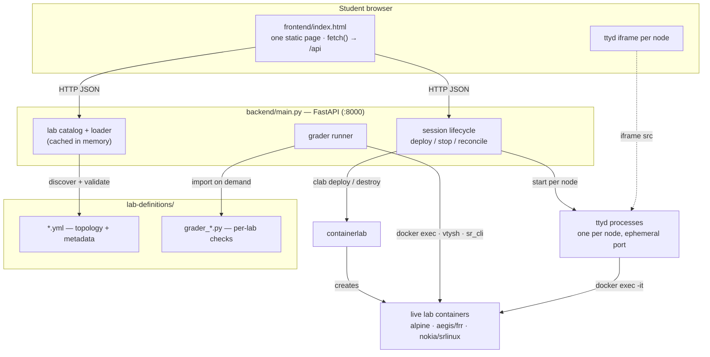
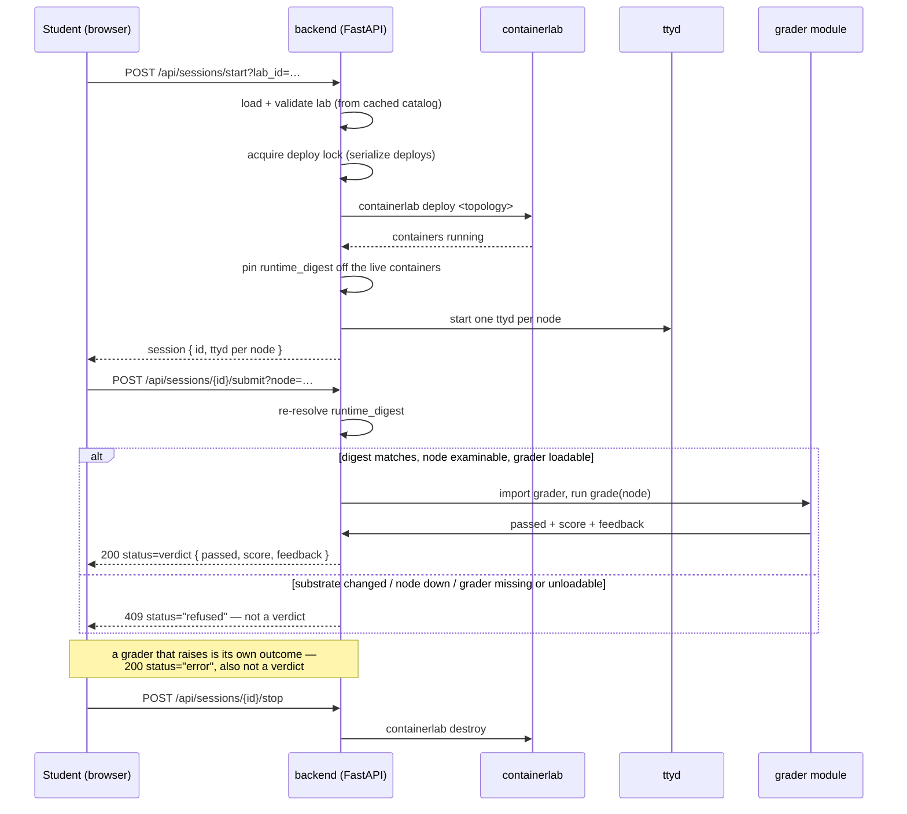

# AEGIS — Architecture

How the pieces fit: what runs where, how a lab starts, and how a config becomes a grade.
Every claim here is read off this tree, not aspirational. Paths are relative to the repo root.

---

## In one paragraph

A single Linux host runs one FastAPI process (`backend/main.py`) on `:8000`. That process
serves a static student page (`frontend/index.html`), discovers lab topologies from
`lab-definitions/`, drives **containerlab** to deploy real containers, wires a **ttyd**
terminal into each node, and grades a student's configuration by inspecting the **live**
containers with a per-lab Python grader. There is no cloud dependency, no database, and no
per-user service — state lives in the process and in the running containers.

---

## Component diagram

---

The rendered version of this exact `mermaid` block is committed at
`docs/assets/architecture-components.png` (rendered with `@mermaid-js/mermaid-cli`, theme `neutral`,
white background; the source above is authoritative — if the two disagree, the source wins and the
PNG needs re-rendering). The README embeds that PNG so the diagram shows up where people actually
land first.

---

## Components

| Path | Role |
|---|---|
| `backend/main.py` | The whole server: FastAPI app, lab discovery/validation, session lifecycle, ttyd wiring, the grader runner, and the runtime-digest gate. Single file by design. |
| `frontend/index.html` | The student UI — one static HTML page (no build step, no framework). Talks to the API with `fetch()` and embeds one `ttyd` iframe per node. |
| `lab-definitions/**/*.yml` | Lab topologies with a `metadata:` block (id, name, gradeable nodes, grader module, daemons). containerlab consumes the `topology:` half. |
| `lab-definitions/grader_*.py` | Per-lab graders, one module per lab (`grader_demo_01_srl.py`, `grader_demo_02.py`), named by each YAML's `metadata.grader`. Imported on demand from inside the grader directory only — a lab file cannot point the loader at code outside it; interface in [`ADDING-A-LAB.md`](ADDING-A-LAB.md). |
| `install.sh` | One-command host setup: Docker, containerlab, ttyd, Python deps, the app copy to `/opt/aegis`, the substrate image, pre-pulled node images, and the systemd unit. |
| `start_server.py` | Foreground launcher for running without the service (see the caveat in [`OPERATIONS.md`](OPERATIONS.md)). |
| `Dockerfile.frr` | Builds the `aegis/frr:latest` substrate — Alpine + FRR with **only** `zebra` and `staticd`; the build asserts `ospfd=no`/`bgpd=no`. |
| `Dockerfile.frr-bgp` *(not in this tree)* | **Deleted 2026-10-30.** It was a second image for dynamic-routing labs that no code path built — `install.sh`'s Step 7b was removed 2026-09-20 (commit `0583677`), and lab-04 (its only would-be consumer) is not in this tree. It survived as unreferenced source until it was removed. This row is kept as a note, not a component: a path rendered with `~~strikethrough~~` still renders as a path, and the section is called *Components*. |
| `assets/frr-image.pin` | **Re-pinned 2026-10-30.** Names the current `Dockerfile.frr` (`b3046a70…`, commit `0503bc5`), records the last known image id from the 2026-09-19 build, and marks the layer chain and the transport tarball `UNPINNED`: no tarball ships in any commit, and no build host was available to re-measure a real image. `install.sh` blanks `UNPINNED` placeholder values, so the pin cannot be mistaken for a hash, and refuses to verify against an `UNPINNED` Dockerfile fingerprint. The live stale-substrate defence is not this file — it is the `aegis.frr.dockerfile.sha256` label Step 7 stamps into the image and rebuilds on. See [`OPERATIONS.md`](OPERATIONS.md) → "Known drift". |
| `tools/` | Maintenance scripts: `check_self_contained.py` (clone-and-install completeness), `lint_lab_pack.py` (pre-solved-lab linter), `check_bundle_fresh.sh`, and the `check_*.py` doc/claim checkers (see [`SECURITY.md`](../SECURITY.md) for the full list and which of them run in CI). |
| `tools/canaries/lab-pack/` | Canary labs for the linter — eight files, one per verdict the linter can emit: two pre-solved on purpose (one of them modelling a switch as a Linux PC), one whose grader raises on import, one with no topology, one naming a grader the pack does not ship, one whose grader ships no `EXPECTED` map, plus one unsolved and one partially-solved lab (`demo2-shape`) to pin the ordinary reads. Each file is named `<label>__<VERDICT>` and `tools/canaries/check_lint_canaries.sh` asserts that verdict for each; `tools/check_canary_pack.py` holds the pack's own `README.txt` list to the same files. Not a lab pack: not discovered by the backend, and it contains solved labs on purpose. |
| `.github/workflows/ci.yml` | CI: backend compiles, `bash -n install.sh`, self-containment check, secret scan. |

---

## Lab lifecycle

- **Deploys are serialized.** A process-wide `_DEPLOY_LOCK` guards `start`, because
  containerlab creates a shared `clab` docker network that two concurrent first-deploys would
  race.
- **Lab definitions are cached in memory** and read once per process; edit a YAML/grader and
  re-grade and you get the old result until `POST /api/labs/reload`.
- **Reconcile on startup:** the server reattaches to containers and reaps orphans rather than
  assuming a clean slate.

---

## The grading path, and why it can refuse

A grade is a **verdict only when the node could actually be examined.** The grader inspects the
running node over `docker exec` (via `vtysh` for FRR, `sr_cli` for SR Linux). The API carries the
outcome in an in-band `status` field with three values — `graded`, `refused`, `error` — so a
broken grader and a wrong answer never look alike. Two gates matter:

- **Identity gate** — each session pins a `runtime_digest` read off the live containers at
  start. Grading re-resolves it and **refuses** (HTTP `409`) if the substrate changed, so a
  grade can't be cited against a substrate it wasn't measured on.
- **Examinability gate** — a node that is down, or a lab whose grader module is missing or cannot be
  loaded, produces a **refusal**, not a silent `pass`/`fail`. Three outcomes exist, not two: a
  **third**, `error`, covers a grader that raises, and it is also not a verdict on the student.

Outcomes and the full refusal vocabulary are in [`GRADING-MODEL.md`](GRADING-MODEL.md). The API
surface is listed in the [README](../README.md#api).

---

## Node substrates: what ships, what is pulled

| image | node | in the repo? |
|---|---|---|
| `alpine:latest` | the PCs (`kind: linux`) | ❌ pulled at deploy time (small) |
| `aegis/frr:latest` | the router in Demo 2 | ❌ built locally by `install.sh` from `Dockerfile.frr` (no image tarball ships in this tree; the pin's tarball is marked `UNPINNED`) |
| `ghcr.io/nokia/srlinux:latest` | the REAL switches (`kind: nokia_srlinux`) | ❌ pulled at deploy time — **~0.75 GB**, single layer (752,789,048 bytes compressed) |

The size is read from the registry manifest, as quoted in the README's *Known limitations*; the
full disk arithmetic lives there. `install.sh` pre-pulls the two registry images before creating
the service, so a blocked registry fails early instead of at first deploy.

---

## Scope boundaries (what this architecture does *not* include)

- **Static routing only.** The substrate asserts `ospfd=no`/`bgpd=no`. No OSPF, BGP, EVPN, or VPNs
  in the shipped labs. There is no dynamic-routing substrate in this tree: the `Dockerfile.frr-bgp`
  that once held one was deleted on 2026-10-30 after being unreferenced for six weeks, and the
  install record publishes one substrate digest, not a set.
- **One host, no database.** Session state is in-process; a host reboot loses running labs
  (containers are not restored on boot), and deploys are serialized per process, not coordinated
  across processes.
- **Two labs.** This tree ships the two demo labs under `lab-definitions/` and nothing else; the
  README's lab table is the authoritative count.

---

## See also

| doc | contents |
|---|---|
| [`OPERATIONS.md`](OPERATIONS.md) | bundle rebuild, runtime digests, concurrency, running without the service, known drift |
| [`ADDING-A-LAB.md`](ADDING-A-LAB.md) | the metadata schema, load-time validation, the grader interface |
| [`GRADING-MODEL.md`](GRADING-MODEL.md) | pass / fail / refused, lab verdict, the digest gate |
